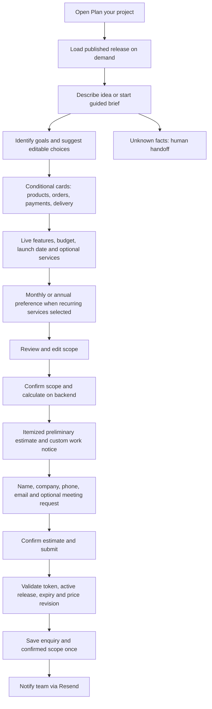

# Project assistant: setup, operation and flow

The assistant turns an idea into an editable project brief and a **preliminary estimate**, then saves a confirmed enquiry in the existing Supabase database. It reuses the existing Resend notification and admin follow-up workflow. It does not accept payments, promise a delivery date, book a meeting, or issue a binding quotation.

## Stack and design

| Part | Implementation |
| --- | --- |
| Public UI | React, responsive dialog, guided cards, lazy JavaScript/CSS |
| Admin UI | `/admin` → **Project assistant**, Supabase Auth + admin membership |
| Backend | Supabase Edge Functions: `chatbot`, `chatbot-admin`, existing `submit-enquiry` |
| Data | Supabase PostgreSQL, RLS, private immutable release snapshots and source chunks |
| Default retrieval | BM25 keyword ranking; no AI account or key required |
| Optional semantic search | Gemini embeddings, 768 dimensions, exact cosine search + reciprocal rank fusion with BM25 |
| Optional intent/source selection | Groq chat model, configurable in server secrets |
| Estimates | Server validates the flow and selections, then calculates from active `feature_options` prices |
| Notifications | Existing Resend integration, with failure tracking and admin retry |

I reviewed the local PortfolioChatbot backend as a reference for Gemini embeddings, Groq, retrieval and Supabase content. MV Studio uses the same provider roles in JavaScript Edge Functions and stores its small knowledge base in Supabase. No separate Python server, Pinecone account or Cloudflare database is needed.

This is retrieval and indexing, **not model training or fine-tuning**. Updating an article changes the draft. Building a release produces a new source index; the live index changes only after publication.

AI selects approved source IDs and relevant goal option IDs. The server filters these IDs and renders the approved excerpts verbatim. This intentionally avoids free-form AI policy statements or AI-generated prices. Without provider keys, editable keyword intent detection, factual excerpts, the entire guided flow, estimates and enquiries still work.

## Customer flow



Example: “I want an online system for my bakery shop” suggests online selling. The customer confirms the goals, product count, ordering/payment/delivery preferences, features, budget, launch preference and optional services. They can go Back, Edit any reviewed answer, or choose “Not sure” where permitted. Changing an earlier choice removes answers for branches that no longer apply.

The product count and budget are scope information. They do not invent a price multiplier or discount. Selecting an online payment goal also does not silently add a paid integration: the customer explicitly selects catalogue features and the team reviews the complete brief. An omitted feature or uncertain scope requires manual review.

## 1. Install the database changes

From the repository root, install dependencies:

```powershell
npm.cmd install
```

**Existing Supabase project:** apply `supabase/migrations/20261024_growth_and_reliability.sql` first if you have not already applied it. Then open **Supabase Dashboard → SQL Editor → New query**, paste the entire [`20261025_chatbot.sql`](../supabase/migrations/20261025_chatbot.sql), and run it.

**New Supabase project:** run the entire [`supabase/schema.sql`](../supabase/schema.sql). It includes both migrations and the existing website, admin and storage setup. Do not create a second database just for the chatbot.

The migration preserves existing website and enquiry records. It adds editable starter articles, questions, options, rules and tests. These are draft content; review them for your actual business before publication. No chatbot release is automatically published.

The migration can be rerun, but its statement triggers conservatively invalidate revision-dependent tests and estimates. Apply it as an installation/upgrade step; do not rerun it on every website deployment. An `on conflict do nothing` seed does not overwrite edited records; deleting a starter record and rerunning the seed migration can recreate that starter.

Admin setup is unchanged: create the account under **Authentication → Users**, then add its user ID in SQL Editor:

```sql
insert into public.admin_users(user_id)
values ('YOUR_AUTH_USER_UUID')
on conflict do nothing;
```

## 2. Configure frontend variables

Create/update `.env.local` for local development:

```env
VITE_SUPABASE_URL=https://idsomvtnofnbtfmlgwum.supabase.co
VITE_SUPABASE_ANON_KEY=YOUR_PUBLISHABLE_OR_ANON_KEY
VITE_SITE_URL=https://mv-aistudio.vercel.app
```

Use the URL and public key for **your** Supabase project. Put the same three variables in **Vercel → Project → Settings → Environment Variables**. Restart Vite after local changes and redeploy Vercel after changing hosted variables.

The public/anon key is expected to be visible in the browser. RLS and Edge Function authorization protect the data. Never put a service-role key, Gemini key, Groq key or Resend key in any `VITE_` variable.

## 3. Configure backend secrets

Open **Supabase → Edge Functions → Secrets**. For the working default mode, use the existing enquiry secrets:

| Secret | Example / purpose |
| --- | --- |
| `ALLOWED_ORIGIN` | `https://mv-aistudio.vercel.app,http://localhost:5173,http://127.0.0.1:5173` |
| `RESEND_API_KEY` | Your server-only Resend API key |
| `RESEND_FROM_EMAIL` | A sender allowed by your Resend account and verified domain |
| `ENQUIRY_TO_EMAIL` | Your team inbox; multiple recipients separated by commas |
| `RATE_LIMIT_SALT` | Optional long random value used to hash connection identifiers |
| `CHATBOT_HOURLY_REQUESTS` | Optional; default 60 per connection, clamped to 10–120 |
| `CHATBOT_DAILY_AI_CALLS` | Optional; default 200 provider requests per UTC database day, maximum 10,000 |
| `CHATBOT_MAX_ANSWER_TOKENS` | Optional; default 400, maximum 700 for source-selection output |

Supabase supplies `SUPABASE_URL` and `SUPABASE_SERVICE_ROLE_KEY` to deployed functions. Do not copy the service-role key into the frontend.

To start, keep **Answer selection = approved excerpts** and **Search method = BM25** in admin. AI keys are unnecessary in this mode.

For optional AI:

| Secret | When required |
| --- | --- |
| `GEMINI_API_KEY` | Hybrid retrieval; obtain from Google AI Studio |
| `GEMINI_EMBEDDING_MODEL` | Optional; defaults to `gemini-embedding-001`. Use the model ID without `models/` |
| `GROQ_API_KEY` | Groq source and goal selection |
| `GROQ_CHAT_MODEL` | Required for Groq mode; use a JSON-capable model available to your Groq account |

Then change the draft settings, build a new candidate, preview it and run tests before publishing. Model IDs and account availability can change; select an available model from your provider dashboard. See the providers' [embedding documentation](https://ai.google.dev/gemini-api/docs/embeddings) and [Groq API compatibility documentation](https://console.groq.com/docs/openai).

The system does not validate a provider account until the relevant build/query actually calls that provider. Test responses marked as degraded/fallback fail the release checks. While live, a provider timeout/quota failure falls back to keyword retrieval and leaves guided estimation available. Server-side daily quotas include indexing, admin preview and release tests; an embedding batch counts as one provider call. Quotas limit requests, not currency spending; configure billing limits with the providers too.

If using a secrets file for CLI deployment, copy `supabase/.env.example` to ignored `supabase/.env.local`, replace its values, and run:

```powershell
npx.cmd supabase secrets set --env-file supabase/.env.local --project-ref idsomvtnofnbtfmlgwum
```

Do not commit that file. Remove optional empty provider entries or replace them before uploading it. Existing Windows `.env` files must be UTF-8 **without BOM** if the CLI reports an unexpected character before the first variable. VS Code's **Save with Encoding → UTF-8** fixes this.

## 4. Deploy the functions

Run these from the folder containing `package.json` and `supabase/`:

```powershell
npx.cmd supabase login
npx.cmd supabase functions deploy chatbot --project-ref idsomvtnofnbtfmlgwum --no-verify-jwt
npx.cmd supabase functions deploy chatbot-admin --project-ref idsomvtnofnbtfmlgwum --no-verify-jwt
npx.cmd supabase functions deploy submit-enquiry --project-ref idsomvtnofnbtfmlgwum --no-verify-jwt
npx.cmd supabase functions deploy retry-enquiry --project-ref idsomvtnofnbtfmlgwum --no-verify-jwt
```

Replace the project reference if your project differs. Deploy the updated `submit-enquiry` too: it now verifies estimate tokens, saves the confirmed chat scope and emails it to the team. The existing retry function remains compatible.

`chatbot` and `submit-enquiry` intentionally accept guests. `chatbot-admin` and `retry-enquiry` verify the bearer JWT through Supabase Auth and check `admin_users` **inside the function**, even with gateway verification disabled. CORS is not authentication.

Test CORS with your exact frontend origin. If Vite uses another port, add it to `ALLOWED_ORIGIN`. A CORS error on OPTIONS often means the function was not deployed successfully; inspect its dashboard logs. Database permission errors require the migration's `service_role` grants, not disabling RLS.

## 5. Prepare and publish in admin

1. Open `http://localhost:5173/admin` after `npm.cmd run dev`, or your deployed `/admin`, and sign in.
2. In **Enquiry features**, enter actual services and prices. Choose `one_time`, `monthly`, or `quote`; use `quote` for work that needs scoping. Set maintenance `annual_free_months` to **1** to charge eleven months annually.
3. Update your actual service scope and policies in **Services & pricing**. They are included as approved knowledge in the next built release.
4. Open **Project assistant**. Edit the name, greeting and handoff message in **Assistant identity & AI configuration**.
5. Use **Knowledge** to add approved FAQs and policies. Do not store customer records, credentials, or promises you cannot support in the knowledge base.
6. Use **Questions** and **Options** to edit the card flow. Question identifiers are lowercase keys; sort order determines execution order. Use **goals** for the main intent card, **features** for database catalogue items, and **billing** for monthly/yearly preference. Billing choices must be exactly `monthly` and `yearly` and cannot allow “Not sure”.
7. Use **Branching** to show a question when earlier answers match. All rules on the target are ANDed; `includes_any` is OR within its list. Choose an earlier source question. `$has_recurring` is a built-in derived condition based on selected recurring features, with `true` / `false` values. Forward dependencies and cycles cannot be published.
8. Enter a candidate label and click **Build candidate**. Hybrid mode embeds its source sections now. The candidate is an immutable snapshot; further draft edits do not alter it.
9. Click **Open private preview**. Try a bakery request, edit earlier choices, generate an estimate, and ask factual/unknown questions. No enquiry, public conversation log or email is created by preview. Optional provider calls still count toward quota.
10. In preview, click **Create quote test from these answers**. Enter a test name and independently calculated expected totals, then save. At least one active quote regression test is required. Add tests for your real prices, custom work, zero selections, and monthly/annual combinations; the starter zero-selection test alone does not cover your business prices.
11. Add answer tests under **Tests**: customer prompt, expected action, required phrases and prohibited phrases. Keep 1–30 active cases. Review the actual excerpts/sources, not just the PASS label.
12. Select the candidate and **Run release checks**. Expand results. Fix failed cases or content, rebuild when draft content changes, and rerun. Tests check structural dependencies, configured answer/quotation cases, restricted feature IDs and price/private-information request handling. These are regression checks, not a guarantee against every possible prompt.
13. Enter review notes, tick the review confirmation, then **Publish candidate**. Public conversations immediately use this release; a frontend rebuild is unnecessary for chatbot content.
14. For a previous published release, select it, rerun checks against current prices/tests/configuration, review it, and **Restore published release**. Rollback does not restore old prices. If server model configuration changed, restore the matching configuration or build a new candidate.

Price changes are intentionally live for the estimator. They invalidate outstanding estimates and passing test reports. Draft article/question changes require a new candidate for publication. Changes to tests require a new test run. Existing conversations receive a restart instruction if their release changes.

To stop the public assistant quickly, use **Pause assistant**. It then offers the normal enquiry form. Draft editing remains available.

## 6. Estimate and enquiry rules

- One-time subtotal = sum of selected active one-time features.
- Monthly subtotal = sum of selected monthly feature prices.
- Annual subtotal = sum of `monthly price × (12 − annual_free_months)` for each recurring feature.
- Money is calculated using integer cents. Numeric totals exclude items marked for manual quotation.
- Every quote is preliminary and requires team review, even if all selected features have prices.
- No hidden tax, transaction fee, provider fee, delivery charge, product-count multiplier or promotion discount is invented. Configure actual catalogue charges; discuss unpriced scope manually.
- The billing choice selects a preference. Annual and monthly recurring totals are alternatives; one-time work is additional.
- The server stores a 30-minute estimate with a random token; only its SHA-256 hash is stored. The browser keeps the token in memory.
- Submission requires the token, confirmation, unchanged price revision and current published release. The database checks freshness again at the final insert to close a concurrent-price-edit window.
- The server derives selected feature IDs, billing and prices from the confirmed estimate, ignoring caller-supplied totals. A request reference and unique estimate reference prevent duplicate saves/notifications.
- Successful retries can retrieve the original submission after its estimate expires; an expired estimate cannot create a new enquiry.
- A preferred meeting time is a request, not a booked calendar slot.

Example: Landing page RM449 + maintenance RM120/month with one annual free month produces **RM449 one-time**, **RM120/month** or **RM1,320/year** recurring. A custom payment feature is additionally flagged for manual pricing.

## 7. Follow up and maintain data

Under **Enquiries**, each chatbot enquiry includes its confirmed brief, readable answers, release reference, selected features, totals and contact details. It uses the existing follow-up statuses and notification retry controls. Resend acceptance is not proof of delivery; inspect provider events for actual delivery problems. A mail failure does not discard the saved enquiry.

The assistant sends only the **current redacted question** and approved knowledge/goal choices to AI providers. It does not send the contact form, entire conversation, enquiry records, secret keys or administrator data. Email addresses and phone-like numbers are masked, but this is not complete PII detection: names, addresses or sensitive text typed into the free-form chat may remain. The UI asks customers to avoid private information. Provider processing and billing are subject to the provider account's terms.

Public chat logs contain redacted questions, replies, source IDs and timing, not contact-form submissions. Admin sees the latest 30. Use the cleanup button under **Recent redacted conversations** regularly: it removes logs older than 30 days, unused estimates that expired over seven days ago, and old usage counters. This cleanup is **manual**, not a scheduled job. Submitted estimates remain associated with enquiry records. Set your own retention process for enquiries and releases; deleting an enquiry does not automatically erase its underlying estimate. For automated cleanup, schedule `select public.chatbot_purge_old_data();` using your database administrator's scheduler. The function is restricted to the service role/database owner.

The implementation deliberately caps this initial knowledge base at 50 active articles and 120 source sections of up to 1,100 characters. Exact vector scoring is suitable for this small corpus. Larger content sets should move retrieval into indexed PostgreSQL/vector queries and add a representative evaluation dataset. See [Supabase hybrid search](https://supabase.com/docs/guides/ai/hybrid-search) for that direction.

## 8. Run checks and deploy the frontend

```powershell
npm.cmd test
npm.cmd run build
npm.cmd run test:browser
```

The Node tests run the real SQL in temporary PostgreSQL and exercise the Edge Function handlers. Browser tests build fixture pages, open Chrome/Edge, manage/publish a release in admin, run the public mobile flow, verify validation and save an enquiry. AI/Resend responses are mocked; tests do not send email, incur AI charges or modify your hosted database. See the root README for browser prerequisites.

After these checks, deploy the React site to Vercel as usual (`npm run build`, output `dist`). The existing public HTML prerendering, page metadata, sitemap and robots remain in place. The launcher is small; conversation code, styles, requests and AI calls load only when a visitor opens it. Published knowledge is not a substitute for crawlable service/project pages.

Finally, verify your actual deployment with your own details: open the widget, request an estimate, send one enquiry, check **Admin → Enquiries**, check Supabase Function logs, and confirm Resend delivery. Optional live model access, email sender verification, production credentials and your actual business content cannot be proven by the isolated local tests.

## Code map

| Location | Responsibility |
| --- | --- |
| `src/chatbot/Launcher.jsx` | Small on-demand entry point |
| `src/chatbot/ChatPanel.jsx` | Shared customer interface and private admin preview |
| `src/admin/ChatbotManager.jsx` | Draft CRUD, settings, tests, preview and publication |
| `supabase/functions/_shared/chatbot/flow.mjs` | Branching, validation, scope summary and quotation rules |
| `.../retrieval.mjs`, `.../providers.mjs`, `.../answer.mjs` | BM25/cosine/RRF, optional provider calls, source-restricted answers |
| `.../data.mjs`, `.../evaluate.mjs`, `.../handler.mjs` | Release indexing, regression checks, public/admin authorization and actions |
| `.../estimates.mjs`, `_shared/submit-handler.mjs` | Estimate confirmation, enquiry persistence and idempotency |
| `supabase/migrations/20261025_chatbot.sql` | Tables, grants/RLS, release transactions, freshness guard and editable seeds |
| `tests/chatbot.test.mjs`, `scripts/browser-check.mjs` | Local backend and browser coverage |
